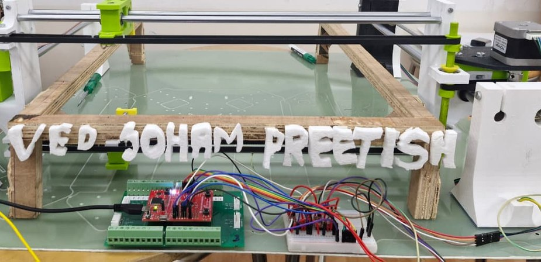
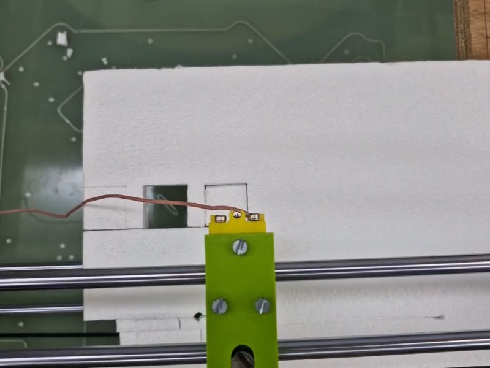
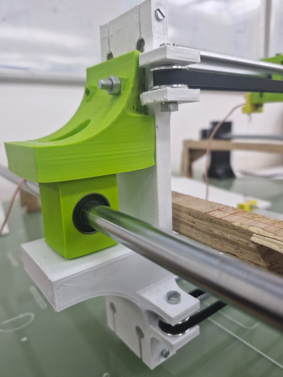
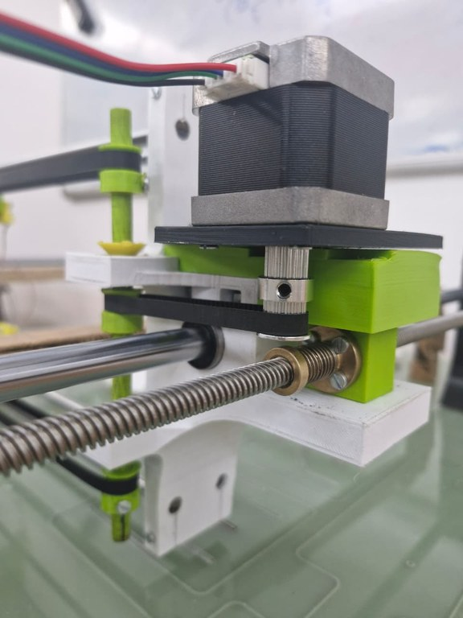
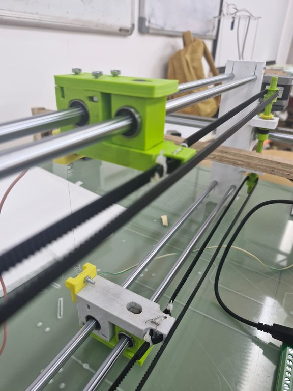
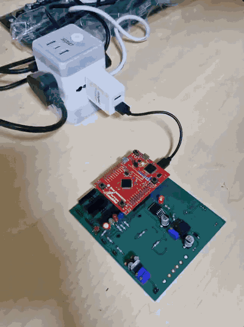

# Precision CNC Foam Cutter

A low-cost 2-DOF CNC hot-wire foam cutter with a GRBL-based controller on a Tiva.

Course project for Design of Mechatronic Systems (ME 6102) at IIT Bombay, Aug 2025 to Nov 2025,
in a 3-member team. Guide: Prof. P. S. Gandhi.

A nichrome hot wire on an X-Y stage cuts foam along a G-code path. The team built the machine
end to end. The design targets were a 40 x 40 cm area and 0.5 mm resolution.

## The machine



*Photo: the X-Y stage, with the Tiva LaunchPad on a screw-terminal board and the stepper driver
modules on a breadboard in front. The foam letters in front spell the team members' first names.*



*Square cut-outs in a foam sheet, with the hot-wire head in front (video frame).*

<p>
  
  
  
</p>

*Photos, left to right: a pin-slot bearing mount, the Y carriage on its lead screw and
spring-loaded anti-backlash nut (the motor on top drives X through a belt to the twin-belt
shaft), and the twin GT2 belts on X.*



*The Tiva LaunchPad seated on the team's PCB, running blink code (phone video).*

All photos and the video are from the course project, 2025.

## How it works

```
LaserGRBL (G-code sender)
  |  UART at 115200 baud, line by line, each line acknowledged
  v
Tiva running the GRBL-based controller
  G-code parser -> motion-block queue -> per-axis step timing
  |
  v
custom PCB with A4988 stepper drivers
  |
  v
NEMA 17 stepper motors: Y on a lead screw, X on twin GT2 belts
```

## What I did

- Designed the X-Y stage with pin-slot compliant bearing mounts, so it moves smoothly even when
  the guide rods are not parallel.
- Drove Y with a lead screw and a spring-loaded anti-backlash nut, and X with twin GT2 belts.
  Each axis has one NEMA 17 stepper motor.
- Printed the motor mounting plates in ABS for its better heat resistance, and the other
  structural parts in PLA.
- Designed and built a custom PCB for the A4988 stepper drivers, power and interfacing around
  the Tiva controller.
- Wrote a GRBL-based controller on the Tiva, with an ASCII G-code parser, a motion-block queue
  and per-axis step timing.
- Streamed G-code from LaserGRBL into the planner over UART at 115200 baud, line by line, with
  an acknowledgement for each line.
- Handled GRBL's real-time commands: feed hold (`!`), resume (`~`), status query (`?`) and soft
  reset (Ctrl-X).
- Handled set-origin homing from a button: move the head to where the origin should be, then
  press the button.

## stream_gcode.py (written in 2026)

This script was written in 2026 for this repo, after the course project. It re-implements the
host side of the streaming, which LaserGRBL did in the project. It is not the original streaming
setup and it was not used in the project.

It opens the port at 115200 baud and sends `$H` (GRBL's homing cycle) first. Then it sends the
G-code file one line at a time and waits for GRBL's `ok` before it sends the next line. It
removes comments in round brackets, cuts each line at the first semicolon and skips empty lines.
It stops at the first `error` or `ALARM`.

```bash
pip install pyserial        # or, on Ubuntu: sudo apt install python3-serial
python3 stream_gcode.py /dev/ttyACM0 shape.nc
```

GRBL accepts `$H` only when homing is turned on in its settings (`$22=1`). Otherwise it answers
with an error (`error:5` in GRBL 1.1), and the script stops before the first G-code line. On the
original machine, homing meant setting the origin with a button.

Tested in 2026 against a small fake GRBL on a Linux pseudo-terminal, not on the machine. The
script sent `$H` and then each line only after the `ok` for the line before, with comments and
empty lines left out. When the fake GRBL answered `error:5` to `$H`, or `error:20` or `ALARM:1`
to a G-code line, the script stopped there with exit code 1 and sent nothing more.


*stream_gcode.py sends the demo file to the fake GRBL. Each line goes out only after the `ok` for
the line before. No machine, real time.*

Try it without the machine (Linux). The fake GRBL in `tools/` and the demo file in `examples/`
were also written in 2026:

```bash
python3 tools/fake_grbl.py ttyFAKE &
sleep 1
python3 stream_gcode.py ttyFAKE examples/square.nc
```

Start the fake GRBL with `--reply '$H=error:5'` to make it answer an error instead. The script
then stops with `RuntimeError: $H -> error:5` and exit code 1. The fake GRBL quits on its own
after the last line, or after 30 s if nothing connects.

## Not in this repo

The original Tiva firmware (the GRBL-based controller described above) and the PCB design files
are not in this repo.
